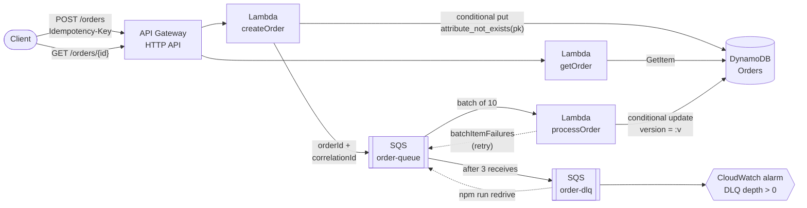

# Relay

[](https://github.com/muhammadw8460/relay/actions/workflows/ci.yml)

An event-driven order processing service on AWS. A client submits an order and gets an ID back right away. The order is processed in the background by a worker that sometimes fails on purpose, and it moves through `PENDING -> PROCESSING -> CONFIRMED | FAILED`. The client polls for the result.

The goal is reliability under at-least-once delivery. Client retries and duplicate SQS deliveries never create a second order or apply a state change twice. See [DESIGN.md](DESIGN.md) for how and why.

**Stack:** TypeScript · AWS Lambda (Node 22, arm64) · API Gateway HTTP API · SQS + DLQ · DynamoDB · AWS CDK · CloudWatch (EMF metrics, alarms, dashboard) · Vitest · k6 · GitHub Actions with OIDC

## Architecture



| Request | Response |
|---|---|
| `POST /orders` with a new `Idempotency-Key` | `201` order in `PENDING`, enqueued for processing |
| `POST /orders` with a key already used, same body | `200` the original order; nothing new is written |
| `POST /orders` with a key already used, different body | `422 IDEMPOTENCY_KEY_REUSED` |
| `POST /orders` with a missing or invalid key or body | `400` with field-level errors |
| `GET /orders/{id}` | `200` order, or `404` |

```bash
curl -s -X POST "$API_URL/orders" \
  -H "content-type: application/json" \
  -H "idempotency-key: 3f1c2a9e-8b7d-4c6e-9f0a-1b2c3d4e5f60" \
  -d '{"customerId":"cust-42","items":[{"sku":"WIDGET-1","quantity":2,"unitPriceCents":1999}]}'
```

```json
{
  "orderId": "ord_5b0e8e4c2f7d1a9b3c6e0f12",
  "status": "PENDING",
  "version": 0,
  "customerId": "cust-42",
  "items": [{ "sku": "WIDGET-1", "quantity": 2, "unitPriceCents": 1999 }],
  "currency": "USD",
  "totalCents": 3998,
  "correlationId": "Ab3xYfGhoAMEbXw=",
  "history": [{ "status": "PENDING", "at": "2026-10-01T17:02:11.418Z" }],
  "...": "..."
}
```

SKUs starting with `OOS-` are always out of stock, so you can force the `FAILED` path.

## How duplicates are prevented

1. **The order ID is derived from the Idempotency-Key**, so every retry targets the same DynamoDB item.
2. **The first write is conditional** (`attribute_not_exists(pk)`). DynamoDB evaluates it atomically, so exactly one of any number of concurrent requests creates the order. The others get the original back.
3. **Every status change is conditional on a `version` number** and bumps it. If SQS delivers a message twice, both copies read the same version, and only one update can succeed.
4. **Terminal states have no outgoing transitions**, so a late redelivery is a no-op.

Tests prove each step: 25 concurrent identical POSTs produce one `201`, and 5 concurrent deliveries of one message produce exactly one `PENDING -> PROCESSING -> CONFIRMED` history.

## Repository layout

```
bin/relay.ts               CDK app entry (Relay-<stage> and RelayBootstrap stacks)
lib/relay-stack.ts         Table, queues, Lambdas, API, IAM, alarms, dashboard
lib/bootstrap-stack.ts     GitHub OIDC provider + deploy role, $5 budget alert
src/handlers/              createOrder, getOrder, processOrder
src/lib/                   validation, state machine, repository, EMF metrics, logger
scripts/                   smoke test, DLQ redrive, table audit
test/unit/                 Vitest + aws-sdk-client-mock; CDK assertion tests
test/integration/          duplicate-submission test against the deployed stack
load/orders.js             k6 ramping-arrival-rate load test
.github/workflows/ci.yml   PR checks; deploy to dev on main via OIDC, then smoke + integration tests
```

## Running it

### Prerequisites

- Node.js 22+ and npm
- An AWS account and the AWS CLI with credentials for it (`aws configure` or `aws sso login`)
- [k6](https://grafana.com/docs/k6/latest/set-up/install-k6/) for the load test

```bash
npm ci
npm test            # unit + infrastructure tests, no AWS needed
npm run lint
npm run typecheck
npx cdk synth       # CloudFormation templates into cdk.out/
```

### One-time AWS setup

```bash
# 1. CDK bootstrap for your account/region
npx cdk bootstrap

# 2. GitHub OIDC deploy role + $5 monthly budget alert
npx cdk deploy RelayBootstrap -c budgetEmail=you@example.com
```

If the account already has a GitHub OIDC provider, add `-c existingOidcProviderArn=arn:aws:iam::<account>:oidc-provider/token.actions.githubusercontent.com`.

Then, in GitHub under **Settings -> Secrets and variables -> Actions -> Variables**, add:

| Variable | Value |
|---|---|
| `AWS_DEPLOY_ROLE_ARN` | the `DeployRoleArn` output from step 2 |
| `AWS_REGION` | e.g. `us-east-1` (optional, this is the default) |

From then on, every push to `main` deploys `Relay-dev` and runs the smoke and integration tests.

### Deploy by hand

```bash
npm run deploy:dev                               # writes cdk-outputs.json
npx cdk deploy Relay-dev -c alarmEmail=you@example.com   # optional: email on alarms
npm run smoke
npm run test:integration                         # INT_N=100 for a bigger run
```

Useful context flags: `-c transientFailureRate=0.1` (default), `-c outOfStockRate=0.05` (default), `-c stage=<name>` for a separate stack.

### Load test

```bash
k6 run -e API_URL=<ApiUrl output> load/orders.js          # ramps to 100 req/s
k6 run -e API_URL=<ApiUrl output> -e PEAK_RPS=50 load/orders.js
npm run audit -- --customer <RUN_ID printed by k6>
```

k6 writes a JSON summary to `load/results/<RUN_ID>.json`. The audit scans the table for that run and fails if it finds more than one order for any key or any order whose history shows a transition applied twice.

> New AWS accounts sometimes start with a Lambda concurrency limit of 10. If the load test shows 429/5xx at higher rates, check **Service Quotas -> Lambda -> Concurrent executions**.

### Operations

```bash
npm run redrive -- --dry-run     # list what's in the DLQ
npm run redrive                  # move it back onto the main queue
npm run audit                    # check invariants across the whole table
```

Trace one request across all three functions in **CloudWatch Logs Insights** (select the three `/aws/lambda/relay-dev-*` log groups):

```
fields @timestamp, handler, level, message, orderId, status, receiveCount
| filter correlationId = "<x-correlation-id response header>"
| sort @timestamp asc
```

### Tear down

```bash
npm run destroy:dev
```

The table and log groups in `dev` use `RemovalPolicy.DESTROY`, so this removes everything. `RelayBootstrap` (the OIDC role and budget) costs nothing to leave in place.

## Observability

| Metric (namespace `Relay`, dimension `Stage`) | Emitted by |
|---|---|
| `OrdersCreated` | createOrder, new order |
| `DuplicateRequestsDetected` | createOrder, replayed key |
| `OrdersConfirmed`, `OrdersFailed` | processOrder, terminal transition |
| `ProcessingLatencyMs` | processOrder, `createdAt` to terminal state |

| Alarm | Condition |
|---|---|
| `relay-dev-dlq-not-empty` | DLQ visible messages > 0 |
| `relay-dev-api-error-rate` | API 5xx / requests > 5% over 5 min |
| `relay-dev-lambda-error-rate` | Lambda errors / invocations > 5% over 5 min |

The `relay-dev` CloudWatch dashboard shows alarm state, order throughput, p50/p99 latency (API and end-to-end), queue depth and age, and Lambda errors and throttles. Its URL is in the stack outputs.

## Results

Load test against `Relay-dev` in `us-east-1`, Lambda arm64 256 MB, 10% injected transient failure rate. Numbers are from `load/results/<RUN_ID>.json` and `npm run audit`.

| Peak target | Throughput | `POST /orders` p50 | p99 | Orders created | Retries deduplicated | Duplicate orders in table |
|---|---|---|---|---|---|---|
| 50 req/s | _pending run_ | | | | | |
| 100 req/s | _pending run_ | | | | | |

End-to-end processing latency (created to CONFIRMED/FAILED), from the `ProcessingLatencyMs` metric: p50 _pending_, p99 _pending_.

## Cost

Everything here is pay-per-request with no always-on resources. Idle cost is $0. A full load test (~15k orders) costs a few cents in Lambda, API Gateway, DynamoDB, and SQS requests. Log groups keep 7 days of data. The bootstrap stack sets a $5/month budget alert as a backstop.

## Notes

- **Node 22, not Node 20.** The original plan said Node 20, but Node 20 reached end of life in April 2026 and AWS Lambda has deprecated the `nodejs20.x` runtime. The functions run on `nodejs22.x`.
- The design trade-offs (standard vs. FIFO queue, at-least-once + idempotency vs. exactly-once, DynamoDB key design, polling vs. webhooks) are in [DESIGN.md](DESIGN.md).
